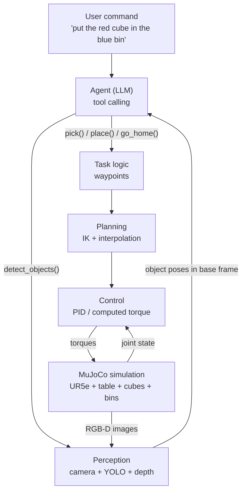
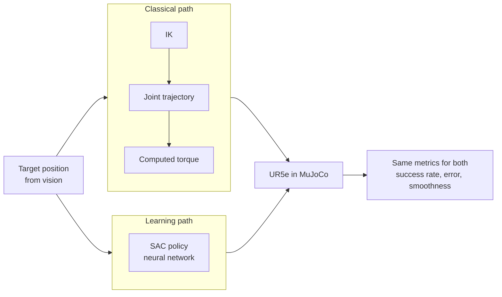
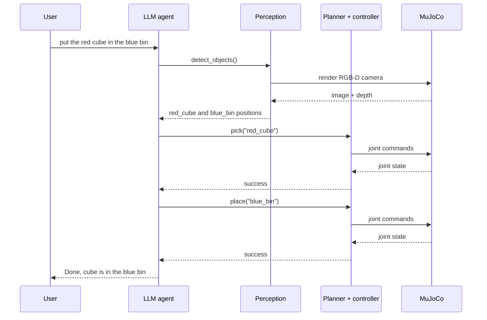
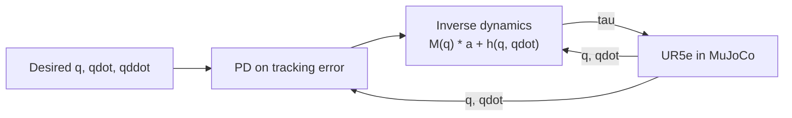
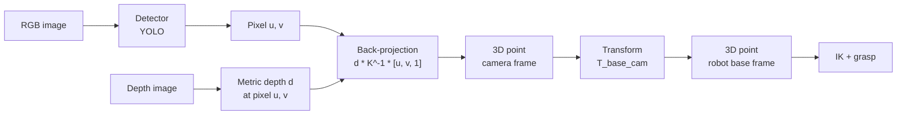

# UR5e Vision + RL Pick-and-Place (MuJoCo)

A simulated UR5e robot arm that sees objects through a camera, plans and executes motions, learns to reach targets with reinforcement learning, and obeys natural-language commands through an LLM agent.

The central question of the project: **where does classical robotics win, where does learning win, and how do the two combine?**

> Status: in progress. Result tables below are placeholders. Fill them only with measured numbers.

## Table of contents

1. [Project at a glance](#1-project-at-a-glance)
2. [Why this project](#2-why-this-project)
3. [System architecture](#3-system-architecture)
4. [Core concepts explained](#4-core-concepts-explained)
5. [Setup](#5-setup)
6. [Roadmap](#6-roadmap-about-5-weeks-810-hweek)
7. [Evaluation](#7-evaluation)
8. [Environment and workflow](#8-environment-and-workflow)
9. [Risks and mitigations](#9-risks-and-mitigations)
10. [Results](#10-results-to-be-filled-with-measured-numbers)
11. [Limitations and next steps](#11-limitations-and-next-steps)
12. [Glossary](#12-glossary)
13. [Learning resources](#13-learning-resources)

---

## 1. Project at a glance

This project builds a complete robot-manipulation pipeline entirely in simulation. A UR5e (a 6-joint industrial arm) stands in front of a table with coloured cubes and bins. The system finds the cubes with a camera, works out where they are in 3D, moves the arm to them, picks them up and sorts them into bins. Every layer is implemented and measured separately, so the final write-up can say not just that it works, but how well each approach works and why.

| Item | Choice |
|---|---|
| Robot | Universal Robots UR5e, 6 DOF (model from MuJoCo Menagerie) |
| Simulator | MuJoCo (CPU, fast, exposes mass matrix and bias forces) |
| Classical robotics | Own FK, Jacobian, damped-least-squares IK, PID, computed-torque control |
| Computer vision | Synthetic dataset from the simulator, OpenCV baseline, YOLOv8n, depth-based 3D localization |
| Reinforcement learning | Gymnasium env, SAC (optionally with HER) from Stable-Baselines3, state-based observations |
| Agent | LLM with tool calling (cloud API or a small local model via Ollama) |
| Hardware | A laptop, no GPU. Colab/Kaggle free GPU only for fine-tuning the detector |
| Environment | WSL2 (Ubuntu) on Windows |
| Estimated time | About 5 weeks at 8-10 hours per week |

## 2. Why this project

- **Comparison, not demonstration.** The same task is solved by classical control and by learning, and the two are compared on measured metrics.
- **It reuses robotics coursework.** Kinematics, dynamics and control methods become the foundation of the code.
- **It runs on a laptop.** Pixel-based RL is excluded, and detector training is the only GPU job.
- **It is honest by design.** Result tables are filled only with measured numbers, and there is a limitations section.

## 3. System architecture

The system is a stack of layers. Each layer has a clear input and output and can be tested alone, so when the full demo fails you can find which layer failed.

| Layer | Responsibility | Input | Output |
|---|---|---|---|
| Agent (LLM) | Understands the request, chooses actions | Natural-language command | Tool calls (detect, pick, place) |
| Task logic | Turns a pick or place into ordered poses | Target object and bin | Waypoints (approach, grasp, lift, drop) |
| Perception | Finds objects and their 3D positions | RGB image + depth map | Object poses in the robot base frame |
| Planning | Converts Cartesian waypoints to joint motion | Target poses | Joint trajectory (IK + interpolation) |
| Control | Makes the arm follow the trajectory | Trajectory + current state | Joint torques or position commands |
| Simulation | Applies physics, renders the camera | Torques | New joint state, images |



The RL policy is an alternative to the planning + control layers for the reaching task: instead of IK plus a controller, a neural network maps the observation directly to joint commands. Keeping both paths behind the same interface is what makes the benchmark fair.



**Example data flow for "put the red cube in the blue bin":**

1. The LLM calls `detect_objects()`.
2. Perception renders the camera, runs the detector and back-projects each detection to 3D (for example red cube and blue bin positions in the base frame).
3. The LLM calls `pick("red_cube")`. Task logic builds waypoints above, at and above the cube again.
4. Planning solves IK for each waypoint and interpolates a smooth joint trajectory.
5. Control tracks the trajectory in simulation while the gripper closes.
6. The LLM calls `place("blue_bin")` and the same chain runs toward the bin.
7. The tool returns success or failure, and the LLM reports the outcome or retries.

The same flow as a sequence diagram:



## 4. Core concepts explained

### 4.1 Simulation with MuJoCo

MuJoCo simulates rigid-body physics. Two objects matter: the **model** (static description: bodies, joints, masses, actuators) and the **data** (changing state: joint positions, velocities, forces). One call advances physics by a small time step. MuJoCo exposes the joint-space mass matrix and the bias forces (Coriolis, centrifugal, gravity), so you can implement model-based control without writing your own dynamics engine.

> **Pitfall:** check how the UR5e model's actuators are defined. If they are position actuators, they already contain a built-in PD controller, which hides the difference between your PID and computed-torque controllers. For torque control, switch the actuators to torque (motor) type in the XML, or apply torques directly and make sure the built-in actuators are not fighting you. A quick test: disable your controller and check that the arm falls.

### 4.2 Forward kinematics (FK)

FK answers: given the six joint angles, where is the end-effector? Each joint contributes a 4x4 homogeneous transform. Multiplying them from base to tool gives the end-effector pose. The standard description of a serial arm is the Denavit-Hartenberg (DH) table, four numbers per joint. Universal Robots publishes the UR5e DH parameters. Use them, and validate against the MuJoCo model, because frame conventions can differ from the manufacturer's.

```
T_0_6(q) = A1(q1) * A2(q2) * A3(q3) * A4(q4) * A5(q5) * A6(q6)
```

Validation: set random joint angles, compute the pose with your FK, read it from MuJoCo, and plot the error. It should be at numerical-noise level once fixed frame offsets are accounted for.

### 4.3 The Jacobian

The Jacobian `J(q)` is a 6x6 matrix relating joint velocities to end-effector velocity (linear and angular): `v = J(q) * qdot`. It is the engine behind numerical IK, it reveals singularities (where `J` loses rank and some motions become impossible), and it connects tool forces to joint torques through `J^T`. Check your analytic Jacobian against finite differences of your FK.

### 4.4 Inverse kinematics (IK)

IK answers the reverse question: which joint angles reach a desired pose? The UR5e has closed-form solutions, but the iterative numerical method is more general and reuses the Jacobian. From an initial guess, compute the pose error `e`, then update:

```
dq = J^T * (J * J^T + lambda^2 * I)^-1 * e
q  = q + dq        # repeat until |e| is small
```

The damping term `lambda` (damped least squares) keeps updates well-behaved near singularities. Handle joint limits, multiple valid solutions (elbow up/down, wrist flip), and pick the solution closest to the current configuration so the arm does not jump.

### 4.5 Dynamics

For a rigid-body arm:

```
M(q) * qddot + C(q, qdot) * qdot + g(q) = tau
```

- `M(q)`: mass (inertia) matrix, which changes with posture
- `C(q, qdot) * qdot`: Coriolis and centrifugal effects
- `g(q)`: gravity torque

Forward dynamics computes motion from torques (what the simulator does). Inverse dynamics computes the torques for a desired motion, which model-based controllers use. In MuJoCo the mass matrix (`mj_fullM`) and the bias term `C*qdot + g` (`qfrc_bias`) are available directly.

### 4.6 PID control

PID computes torque from tracking error: proportional (how far off), integral (accumulated error, removes steady offset) and derivative (rate of change, adds damping). Applied per joint it is simple and often good enough. Its weakness: gravity, joint coupling and payload are treated as disturbances rejected only after they cause error, so tracking degrades in fast motions or when the payload changes.

### 4.7 Computed-torque control

Computed torque (inverse-dynamics control) uses the model to cancel the arm's nonlinear dynamics, then closes a simple PD loop around what remains:

```
tau = M(q) * ( qddot_des + Kd*(qdot_des - qdot) + Kp*(q_des - q) ) + h(q, qdot)
      where h = C(q, qdot)*qdot + g(q)      # MuJoCo's qfrc_bias
```



With an accurate model, the closed-loop error behaves like a clean linear system, so `Kp` and `Kd` set the response. The key experiment is the **payload test**: add mass at the end-effector that the controller's model does not know about, and compare how PID and computed torque degrade.

### 4.8 Perception: from pixels to robot coordinates

**Synthetic data.** Instead of photographing and hand-labelling cubes, the simulator generates the dataset. Randomize cube colours, positions, lighting and camera pose, render each image, and use MuJoCo's segmentation output to compute bounding boxes automatically. A few thousand images are usually enough. Randomization lets the detector handle variation instead of memorizing one scene.

**Detection.** Start with an OpenCV colour-threshold baseline: no training, and it shows how hard the problem actually is. Then fine-tune YOLOv8n (runs acceptably on CPU). Train once on a free Colab GPU, then run inference locally.

**Localization.** A detector gives a pixel `(u, v)`. The depth image gives the distance `d` along the camera axis at that pixel. With the intrinsics matrix `K` (focal lengths `fx, fy`, principal point `cx, cy`):

```
X_cam  = d * K^-1 * [u, v, 1]^T
X_base = T_base_cam * X_cam
```



> **Pitfalls:** MuJoCo returns depth as a normalized buffer that must be converted to metric distance using the camera's near and far clipping planes. MuJoCo cameras also follow the OpenGL convention (looking along negative z of the camera frame), unlike the usual computer-vision convention, so axis signs are a frequent cause of cubes appearing in the wrong place. Validate by comparing computed 3D positions to the cube's true position, which the simulator knows exactly.

### 4.9 Reinforcement learning

An agent observes a state, takes an action and receives a reward; the goal is a policy that maximizes cumulative reward. Formulation here:

- **Observation:** joint positions, joint velocities, target position (for example from the vision module)
- **Action:** small joint-velocity or joint-position changes (continuous, smooth)
- **Reward:** negative distance between end-effector and target, a small penalty on large actions, and a success bonus

**SAC (Soft Actor-Critic)** fits: it handles continuous actions, is sample-efficient compared with on-policy methods, and its entropy bonus encourages exploration. If the reward is sparse, **Hindsight Experience Replay (HER)** relabels failed attempts as successes for the positions they actually reached, which speeds learning substantially (it needs a goal-conditioned, dictionary-style observation).

**Why state-based, not pixel-based:** learning from raw images needs far more samples and a GPU. With joint states plus target position the networks are tiny, so CPU physics is the bottleneck and training takes hours, not days.

Always run SB3's `check_env`, evaluate on many random targets with fixed seeds, and run more than one seed before drawing conclusions.

### 4.10 The LLM agent

Tool calling lets a language model request actions. You describe each function with a name, description and JSON schema for its parameters. The model replies with a structured call request, your code executes it and returns the result, and the model continues. The model never touches the robot directly; it only chooses among safe, validated functions.

| Tool | What it does |
|---|---|
| `detect_objects()` | Renders the camera, runs the detector, returns objects with 3D positions |
| `pick(object_id)` | Runs IK and the scripted grasp sequence on the named object |
| `place(bin_id)` | Moves above the bin, lowers, releases |
| `go_home()` | Returns to a safe home configuration |

Guardrails belong in the tools, not the prompt: validate every argument, reject unreachable targets, enforce joint and workspace limits, and return clear error messages so the model can retry sensibly.

---

## 5. Setup

Recommended: WSL2 (Ubuntu) on Windows. Keep the repo in the Linux home directory (`~/ur5-vision-rl`), not under `/mnt/c`.

```bash
python3 -m venv .venv
source .venv/bin/activate
pip install mujoco numpy matplotlib pin gymnasium "stable-baselines3[extra]" opencv-python ultralytics
git clone https://github.com/google-deepmind/mujoco_menagerie.git
```

- Headless rendering (Colab, servers): `export MUJOCO_GL=egl`
- If the MuJoCo viewer does not open in WSL, try `export MUJOCO_GL=glfw`, or render to video files.
- If `pin` fails to install, use `conda install -c conda-forge pinocchio` or postpone it. MuJoCo alone can validate FK.

Create the repo structure:

```bash
mkdir -p kinematics control vision rl agent experiments notebooks
touch kinematics/__init__.py control/__init__.py vision/__init__.py rl/__init__.py agent/__init__.py
```

```
ur5-vision-rl/
├── kinematics/    # FK, Jacobian, IK, validation vs Pinocchio
├── control/       # PID, computed torque, (optional) operational space
├── vision/        # synthetic data generation, detector, 3D localization
├── rl/            # Gymnasium env, training, evaluation
├── agent/         # LLM tool layer
├── experiments/   # scripts that generate the plots in this README
├── notebooks/     # thin Colab notebooks that call the repo modules
└── README.md
```

## 6. Roadmap (about 5 weeks, 8-10 h/week)

### Phase 0: Setup (2-3 days)

- [ ] Install dependencies and clone MuJoCo Menagerie
- [ ] Create the repo structure, commit daily
- [ ] Load the UR5e, step the sim, read joint angles and the end-effector pose

**Done when:** you can print the end-effector position for arbitrary joint angles and render an image.

### Phase 1: Kinematics (week 1)

- [ ] FK from DH parameters, validated against MuJoCo's end-effector pose
- [ ] Geometric Jacobian, checked with finite differences
- [ ] Numerical IK (damped least squares) with singularity handling and joint limits
- [ ] Straight-line Cartesian trajectory following

**Deliverable:** end-effector error plot (own FK vs MuJoCo vs Pinocchio) and an IK success-rate table.

### Phase 2: Dynamics and control (week 2)

- [ ] Joint-space PD / PID on a smooth trajectory
- [ ] Computed-torque control using `mj_fullM` and `qfrc_bias`
- [ ] Payload experiment: add unmodelled mass, compare PID vs computed torque
- [ ] Optional: task-space (operational space) control

**Deliverable:** tracking-error and torque-effort plots, with and without payload.

### Phase 3: Vision and pick-and-place (week 3)

- [ ] Add an RGB-D camera to the scene
- [ ] Generate and auto-label a synthetic dataset with randomization
- [ ] OpenCV color-threshold baseline, then fine-tune YOLOv8n on Colab
- [ ] 3D localization: pixel + depth -> camera frame -> robot base frame
- [ ] Scripted grasp: approach, descend, close, lift, move to bin, release

**Deliverable:** demo video of the arm sorting cubes, detection precision/recall, localization error, pick success rate.

### Phase 4: Reinforcement learning (week 4)

- [ ] Gymnasium env (reset, step, reward, termination) and `check_env`
- [ ] Train SAC with parallel envs (add HER if the reward is sparse)
- [ ] Evaluate on 100+ random targets and compare with the IK controller

**Deliverable:** learning curves and a classical-vs-RL comparison table with an honest conclusion.

### Phase 5: LLM agent and polish (week 5)

- [ ] Wrap `detect_objects`, `pick`, `place`, `go_home` as tools with JSON schemas
- [ ] LLM loop with retries and guardrails
- [ ] Record the demo, add an architecture diagram, fill in results and limitations

**Deliverable:** a repo someone else can clone and run.

## 7. Evaluation

Decide the metrics before running experiments, use many trials, and report failures as well as successes.

| Experiment | Metric | What it tells you |
|---|---|---|
| FK validation | Max position and orientation error vs MuJoCo | Whether the kinematic model is correct |
| IK | Success rate and iterations over N random reachable targets | Robustness near singularities and limits |
| PID vs computed torque | RMS tracking error and torque effort, with and without payload | Value of the dynamic model and its sensitivity to model error |
| Detection | Precision, recall, CPU inference time | Whether the detector is usable in the loop |
| Localization | 3D position error vs simulator ground truth | Correctness of calibration and geometry |
| Pick-and-place | Success rate over N trials, failure causes | End-to-end reliability |
| RL vs classical IK | Success rate, final error, smoothness, training cost, several seeds | Where learning helps and where it does not |

## 8. Environment and workflow

| Task | Where |
|---|---|
| FK, IK, PID, computed torque | Local (WSL) |
| Synthetic data generation | Local, or Colab for speed |
| YOLO fine-tuning | Colab / Kaggle GPU |
| SAC training | Local, or Colab for longer runs (CPU physics is the bottleneck, so a GPU barely helps) |
| Final demo and agent | Local, using downloaded weights |

- Develop and debug locally, push to GitHub, then clone into Colab for heavy runs.
- Save checkpoints to Google Drive regularly (SB3 `CheckpointCallback`), since Colab sessions can disconnect.
- Keep logic in repo modules and call it from thin notebooks, so no code lives only in a notebook.
- Do not commit the virtual environment, the Menagerie clone or large training outputs. Link the demo video from this README instead of storing it in the repo.

Suggested `.gitignore`:

```
.venv/
__pycache__/
*.pyc
mujoco_menagerie/
runs/
.ipynb_checkpoints/
```

## 9. Risks and mitigations

| Risk | Mitigation |
|---|---|
| Controllers behave identically because actuators already contain a PD loop | Use torque-type actuators or apply torques directly; verify by disabling your controller |
| Cubes appear in the wrong place after back-projection | Check depth conversion and the OpenGL camera convention; compare with ground-truth positions |
| RL does not learn | Start with an easy task (fixed target, small workspace), check reward scale, use HER for sparse rewards, run several seeds, accept an honestly measured negative result |
| Training too slow on CPU | Parallel envs, small networks, shorter episodes; use a GPU only for the detector |
| Learning a grasp from scratch is too hard | Use a scripted grasp primitive and apply learning to reaching |
| Pinocchio fails to install | Use conda-forge, or postpone it |
| Scope grows beyond the time available | Phases 1-3 already make a complete project; treat RL and the agent as a second release |

## 10. Results (to be filled with measured numbers)

| Experiment | Metric | Result |
|---|---|---|
| FK validation | Max position error vs MuJoCo | TBD |
| IK | Success rate over N random targets | TBD |
| PID vs computed torque | RMS tracking error (no payload / payload) | TBD |
| Detection | Precision / recall (synthetic test set) | TBD |
| Localization | Mean 3D error vs ground truth | TBD |
| Pick-and-place | Success rate over N trials | TBD |
| RL vs classical IK | Success rate, final error, smoothness | TBD |

## 11. Limitations and next steps

**Limitations (to update)**

- Simulation only; no sim-to-real transfer yet.
- Grasping uses a scripted primitive, not a learned grasp.
- RL is state-based (not pixel-based) to stay CPU-friendly.

**Next steps / ideas**

- Pixel-based or domain-randomized RL policy trained on a GPU
- Learned grasping
- Sim-to-real on a low-cost arm
- ROS 2 / MoveIt 2 integration

## 12. Glossary

| Term | Meaning |
|---|---|
| DOF | Degrees of freedom: independent ways the robot can move (the UR5e has 6) |
| DH parameters | Four numbers per joint describing a serial arm's geometry |
| FK / IK | Forward kinematics (joints to pose) / inverse kinematics (pose to joints) |
| Jacobian | Matrix relating joint velocities to end-effector velocity |
| Singularity | Configuration where the Jacobian loses rank and some motions become impossible |
| End-effector | The tool at the end of the arm (gripper) |
| Mass matrix M(q) | Posture-dependent inertia of the arm in joint space |
| Computed torque | Control law using inverse dynamics to cancel nonlinear effects |
| Intrinsics (K) | Camera parameters: focal lengths and principal point |
| Back-projection | Turning a pixel plus depth into a 3D point |
| Domain randomization | Varying colours, lighting and poses in simulation so models generalize |
| Policy | Function (here a neural network) mapping observations to actions |
| SAC | Soft Actor-Critic, an off-policy RL algorithm for continuous actions |
| HER | Hindsight Experience Replay, a trick for learning from sparse rewards |
| Tool calling | LLM feature where the model requests calls to developer-defined functions |

## 13. Learning resources

Where something is slides or an article rather than a video, it is marked.

**Kinematics, dynamics and control**
- [Modern Robotics video series (Class Central playlist)](https://www.classcentral.com/classroom/youtube-modern-robotics-all-videos-48187)
- [Chapter 6: Inverse kinematics](https://modernrobotics.northwestern.edu/chapters/chapter6)
- [Chapter 8: Dynamics of open chains](https://modernrobotics.northwestern.edu/chapters/chapter8)
- [Chapter 11: Robot control](https://modernrobotics.northwestern.edu/chapters/chapter11)
- [11.4: Computed torque](https://modernrobotics.northwestern.edu/nu-gm-book-resource/11-4-motion-control-with-torque-or-force-inputs-part-3-of-3/)

**MuJoCo**
- [MuJoCo-Tutorial notebooks (Colab-friendly)](https://github.com/tayalmanan28/MuJoCo-Tutorial)
- [MuJoCoPy Bootcamp](https://pab47.github.io/mujocopy.html) and its [video playlist](https://www.youtube.com/playlist?list=PLc7bpbeTIk758Ad3fkSywdxHWpBh9PM0G)
- [MujocoTutorials: `robot_arms.ipynb` with UR5e](https://gitee.com/intheposition/MujocoTutorials)
- [TorchRL tutorial with a Menagerie UR5e](https://docs.pytorch.org/rl/stable/tutorials/mujoco_cube_bowl_macros.html)

**Computer vision**
- [Ultralytics: YOLOv8 custom training in Colab](https://www.ultralytics.com/blog/training-custom-datasets-with-ultralytics-yolov8-in-google-colab) (includes video)
- [Camera projection lecture slides](https://yuxng.github.io/Courses/CS4391Spring2025/lecture_11_camera_projection.pdf) (slides, not video)

**Reinforcement learning**
- [SB3 + Gymnasium quickstart](https://araffin.github.io/slides/sb3-gym-quickstart) (slides)
- [RL tips and tricks](https://www.youtube.com/watch?v=Ikngt0_DXJg) (video)
- [Recent advances in RL for continuous control](https://www.youtube.com/watch?v=Sb0dgmxbGZY) (video)
- [SB3 custom environment guide](https://stable-baselines3.readthedocs.io/en/master/guide/custom_env.html)

**LLM agents**
- [Robot Arm Control Lesson](https://shepai.github.io/tutorials/robotarm.html) (LLM + MuJoCo arm)
- [AI Agent Tutorial 3: Tool Calling](https://medium.com/@xzw0005/ai-agent-tutorial-3-tool-calling-b46d02d63eb6) (article)

## References

- Lynch & Park, *Modern Robotics: Mechanics, Planning, and Control* (Cambridge University Press, 2017)
- [MuJoCo](https://github.com/google-deepmind/mujoco) and [MuJoCo Menagerie](https://github.com/google-deepmind/mujoco_menagerie)
- [Stable-Baselines3](https://github.com/DLR-RM/stable-baselines3)
- [Ultralytics YOLO](https://www.ultralytics.com/)

## License

MIT (or your choice)